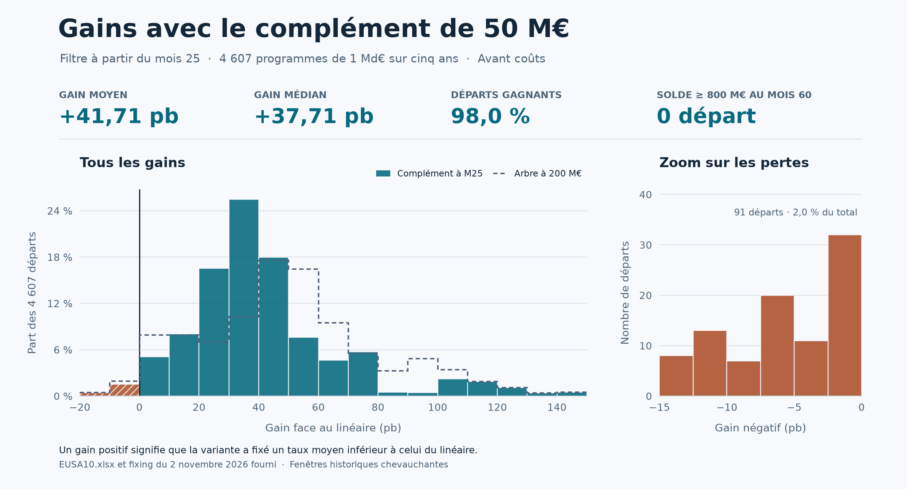
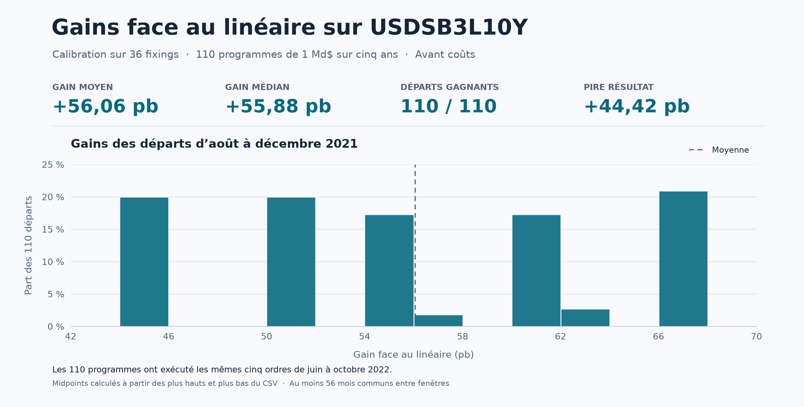

# Couverture de taux

Implémentation d’une couverture par swaps payeurs de fixe de dix ans, avec 60 dates de décision. Le test compare le taux fixe moyen pondéré à celui d’un programme qui couvre 1/60 du notionnel à chaque fixing.

## Explications et code

- [Explications](docs/explications.md) · texte repris mot pour mot du document fourni, avec les formules et les schémas.
- [Document PDF original](docs/explications.pdf) · [source LaTeX](docs/explications.tex).
- [Code de calibration et de décision](reproduction/_eusa10-opportunites-50-200-work/signal_complement.py) · [point d’entrée du backtest](lancer.py).

## Résultats face au linéaire

Un gain positif mesure la baisse du taux fixe moyen pondéré par rapport au linéaire. Les résultats sont calculés avant coûts d’exécution.

| Série | Calibration | Programmes de cinq ans | Gain moyen | Médiane | Départs gagnants | Pire résultat |
| --- | ---: | ---: | ---: | ---: | ---: | ---: |
| EUSA10 | 60 fixings | 4 607 | +41,71 pb | +37,71 pb | 4 516 sur 4 607 (98,0 %) | −14,53 pb |
| USDSB3L10Y | 36 fixings | 110 | +56,06 pb | +55,88 pb | 110 sur 110 | +44,42 pb |

### EUSA10

Les 4 607 départs s’étalent du 2 janvier 2004 au 31 décembre 2021. Les programmes couvrent 1 Md€. Le dernier fixing fourni, le 2 novembre 2026 à 3,40100 %, entre dans 23 programmes. Les fenêtres historiques se chevauchent.

[Résultats par départ](resultats/eusa10/departs.csv) · [Statistiques](resultats/eusa10/statistiques.json) · [Classeur EUSA10](donnees/originaux/EUSA10.xlsx)

### USDSB3L10Y

Le test exploratoire couvre 1 Md$ sur cinq ans. Les 100 mois utilisables dans le fichier donnent une calibration de 36 fixings pour les départs d’août à décembre 2021. La version à 60 fixings de calibration demande 120 mois pour observer aussi les 60 fixings de couverture.

Les 110 programmes partagent au moins 56 mois. Ils exécutent les mêmes cinq ordres de 200 M$ du 1er juin au 3 octobre 2022 et fixent un taux de 3,12778 %. Le linéaire atteint 3,68836 % en moyenne sur ces départs.

Le taux utilisé est le milieu entre le plus haut et le plus bas de la séance. Ces extrêmes sont connus en fin de séance. Le fichier contient 54 valeurs « Dernier » en dehors des fourchettes publiées, dont celle du 3 octobre 2022. Le rejeu utilise les plus hauts et plus bas fournis.

[Résultats par départ](resultats/usdsb3l10y/departs.csv) · [Statistiques](resultats/usdsb3l10y/statistiques.json) · [Classeur USDSB3L10Y](donnees/originaux/USDSB3L10Y.xlsx) · [CSV source](donnees/originaux/USDSB3L10Y.csv)

## Vidéos

Les [dix rejeux et les deux explications](https://github.com/TPMHSN/couverture-taux/releases/tag/v1.0.0) montrent les décisions sur des fenêtres historiques EUSA10. Les rejeux affichent le taux, la surface de décision, les ordres et le gain face au linéaire.

## Relancer les calculs

Python 3.12 et le runtime .NET 9 permettent de relancer les scripts. Le rejeu EUSA10 utilise les seuils archivés. Le rejeu USD les recalcule sur les fixings de la série USD.

~~~sh
python -m pip install -r requirements.txt
python lancer.py eusa10
python lancer.py usd
~~~

Les commandes écrivent les résultats dans sorties/. Le rejeu EUSA10 utilise le classeur original. Le rejeu USD calcule le milieu haut-bas depuis le CSV source, selon la même formule que le classeur Excel.
