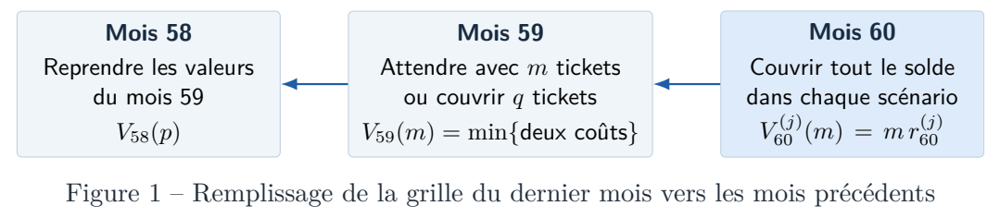
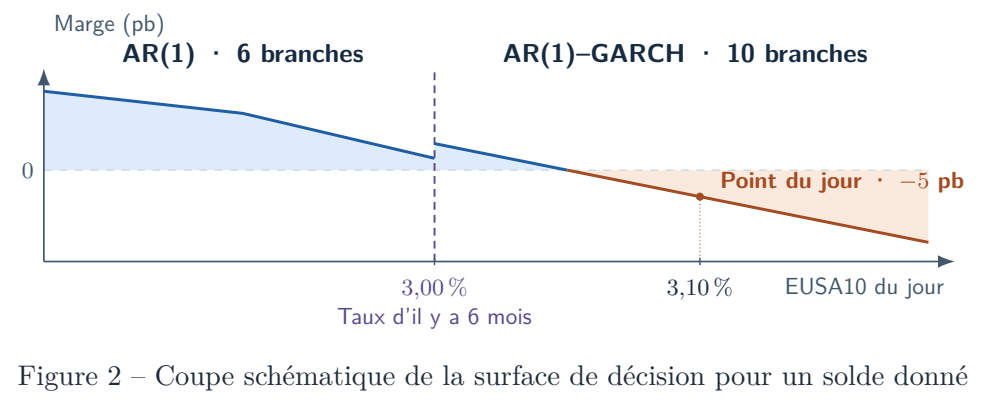

# Introduction

## Option d'achat européenne

Supposons qu'on soit boulanger. Dans 6 mois, nous aurons une commande pour l'anniversaire d'un client. Il nous faudra donc beaucoup de farine, et donc de blé. Mais dans 6 mois, quel sera le prix de la tonne de blé ? Aurons-nous assez ? En payant une prime aujourd'hui, on peut acheter un call qui nous donne le droit, sans obligation, d'acheter une tonne de blé au prix $K$ dans 6 mois.

Si $S_T$ est le prix de la tonne à l'échéance, le payoff du call est $\max(S_T-K,0)$. Sa valeur à l'instant $t$ est l'espérance conditionnelle de ce payoff actualisé sous la mesure risque neutre $\mathbb{Q}$.

$$
V_t=M_t\,\mathbb{E}^{\mathbb{Q}}\left[\frac{\max(S_T-K,0)}{M_T}\,\middle|\,\mathcal{F}_t\right].
$$

Ici, $M_t$ est la valeur du compte monétaire et $\mathcal{F}_t$ représente l'information disponible à la date $t$.

## Option d'achat américaine

Maintenant, si le maximum d'invités est disponible un mois avant la date prévue, on peut avancer l'anniversaire. Le call européen s'exerce au mois 6. Pour pouvoir exercer plus tôt, on peut acheter un call américain, exerçable à tout moment jusqu'à l'échéance. Pour le calcul, on se donne des dates d'exercice mensuelles. Sur cette grille, l'option est dite bermudéenne. Mais comment la pricer ?

Un exercice de pensée est de se dire que si on attend au mois 5, la seule date d'exercice restante est le mois 6. On garde donc l'option si la valeur d'attendre le mois 6 est supérieure au payoff d'exercice immédiat. Et si on a encore l'option au mois 5, c'est qu'on avait déjà choisi d'attendre au mois 4 en faisant la même comparaison.

On se rend compte qu'il faut raisonner *backward*. On compare le payoff immédiat $H_{n-1}$ à la *continuation value* $C_{n-1}$.

$$
V_{n-1}=\max\{H_{n-1},C_{n-1}\},
\qquad
C_{n-1}=M_{n-1}\,\mathbb{E}^{\mathbb{Q}}\left[\frac{V_n}{M_n}\,\middle|\,\mathcal{F}_{t_{n-1}}\right].
$$

On note $H_n=\max(S_{t_n}-K,0)$ et $M_n=M_{t_n}$. Au mois 6, on a $V_N=H_N$. Pour chaque scénario du prix du blé, on peut donc calculer le payoff final et en déduire la valeur d'attendre au mois 5.

$$
C_{N-1}=M_{N-1}\,\mathbb{E}^{\mathbb{Q}}\left[\frac{H_N}{M_N}\,\middle|\,\mathcal{F}_{t_{N-1}}\right].
$$

Une fois qu'on a comparé $C_{N-1}$ au payoff immédiat du mois 5, on connaît $V_{N-1}$. On peut alors refaire le même calcul au mois 4, puis remonter de mois en mois.

## Problème de couverture

C'est en partant de ce raisonnement que j'ai eu l'idée de voir la couverture du milliard comme un problème de récurrence *backward*, comme dans le livre. Au mois 60, on doit couvrir tout le solde. On part donc de ce mois et on remonte. À chaque étape, on compare le coût attendu si on attend avec le solde entier au coût de couvrir un ticket tout de suite et de poursuivre avec le reste. Comme on cherche à minimiser le taux moyen payé, on retient le plus petit des deux coûts.

# Implémentation de la stratégie

## L'arbre

On va donc construire un arbre qui représente les taux possibles du mois $t$ au mois 60 selon le modèle. Entre deux mois, il y a 6 ou 10 branches. Ce qui fait $6^{60-t}$ ou $10^{60-t}$ chemins jusqu'au dernier mois si on déplie tout l'arbre. En pratique, quand plusieurs chemins arrivent au même état, on réutilise la même case de la grille.

Comment sont choisis les taux des branches ? On modélise les taux mensuels par un AR(1), car le taux du mois courant donne un point de départ simple pour estimer celui du mois suivant. On part donc de $a+\phi r_t$, que l'on choque pour obtenir plusieurs directions.

$$
r_{t+1}^{(j)}=a+\phi r_t+\sigma z_j.
$$

Pour l'arbre à 6 branches, on calibre l'AR(1) sur les 60 fixings qui précèdent le lancement. La régression donne $a$ et $\phi$. On estime ensuite $\sigma$, l'écart-type des erreurs entre les taux observés et ceux donnés par l'AR(1).
Maintenant, on se place au mois $t-1$ avec un taux $r_{t-1}$. On part de la prévision $a+\phi r_{t-1}$ et on ajoute un choc $\sigma z_j$ pour obtenir chacun des 6 taux possibles au mois $t$.
$$
r_t^{(j)}=a+\phi r_{t-1}+\sigma z_j,\qquad j\in\{1,2,3,4,5,6\}.
$$
On tire les 6 valeurs de $z_j$ une seule fois dans la gaussienne $\mathcal{N}(0,1)$. Chaque branche a un poids de $1/6$. Pour passer au mois $t+1$, on repart de chacun des 6 taux obtenus et on refait le même calcul avec les mêmes $z_j$.

Si le taux du jour est supérieur à celui d'il y a 6 mois, on passe à l'arbre à 10 branches. À chaque début de mois, on recalibre l'AR(1) sur les 60 fixings précédents pour obtenir $a$ et $\phi$. On calibre ensuite un GARCH(1,1) sur les erreurs de l'AR(1) pour obtenir $\omega$, $\alpha$ et $\beta$. Le GARCH remplace le $\sigma$ constant de l'AR(1) par une volatilité $\sigma_t$ propre au mois qu'on veut projeter. On l'estime à partir des écarts entre les taux observés sur le marché et ceux donnés par l'AR(1)..

Maintenant, on se place au mois $t-1$ avec un taux $r_{t-1}$. On calcule l'erreur de l'AR(1) pour ce mois, $e_{t-1}=r_{t-1}-(a+\phi r_{t-2})$. Le GARCH utilise cette erreur et la variance du mois précédent pour calculer la variance du choc au mois $t$.

$$
\sigma_t^2=\omega+\alpha e_{t-1}^2+\beta\sigma_{t-1}^2.
$$

On part de la prévision $a+\phi r_{t-1}$ et on ajoute un choc $\sigma_t z_j$ pour obtenir chacun des 10 taux possibles au mois $t$.

$$
r_t^{(j)}=a+\phi r_{t-1}+\sigma_t z_j,\qquad j\in\{1,\ldots,10\}.
$$

On choisit les 10 valeurs de $z_j$ et leurs poids avec la méthode de Gauss–Hermite pour représenter la gaussienne $\mathcal{N}(0,1)$. Les chocs proches de zéro ont plus de poids. Pour passer au mois $t+1$, on repart de chacun des 10 taux obtenus. On utilise le choc de chaque branche, $\sigma_t z_j$, comme erreur dans le GARCH pour calculer la volatilité du mois suivant sur cette branche.

Une fois l'arbre obtenu, on peut faire le raisonnement *backward* annoncé en introduction. Pour chaque mois, on construit une grille avec en colonne le nombre de tickets restants et en ligne les niveaux de taux possibles. Avec le GARCH, on a aussi une grille par niveau de volatilité. Dans chaque case, on met le coût attendu pour finir de couvrir le solde à partir de cet état, en prenant la meilleure décision selon l'arbre à chaque mois.

Comment sont calculés les meilleurs décisions? Au mois 60, on connaît le taux de chaque scénario. S'il reste $m$ tickets de 50 M€ dans le scénario $j$, on couvre tout au taux $r_{60}^{(j)}$. Le coût vaut donc $V_{60}^{(j)}(m)=m\,r_{60}^{(j)}$. C'est l'équivalent de notre $H_N$ pour cette case de la grille.

Maintenant, on est au mois 59 et il nous reste $m$ tickets avant de décider. Si on attend, il en restera $m$ au mois 60. Si on couvre maintenant, on traite $q=\min(4,m)$ tickets, puisque l'ordre standard est de 200 M€, soit 4 tickets de 50 M€. Il en restera donc $m-q$ au mois 60.

Maintenant, comment savoir si ça vaut le coup de couvrir au mois 59 ? Si on attend, combien vont nous coûter les $m$ tickets au mois 60 ? Ça dépend du taux sur lequel on tombe, donc on fait la moyenne pondérée des branches du mois 60 (si on attend le mois 60). Si on couvre $q$ tickets maintenant, on connaît déjà leur coût, $q\,r_{59}$, et il restera $m-q$ tickets à couvrir au mois 60. On refait alors la même moyenne pour les $m-q$ tickets qu'il nous restera au mois 60, puis on ajoute le coût des $q$ tickets qu'on a couverts au mois 59. Si c'est moins cher de couvrir au mois 59, alors on fait ça. Sinon, l'arbre attend le mois 60.

$$
V_{59}(m)=\min\left\{\sum_j p_j V_{60}^{(j)}(m),\quad q\,r_{59}+\sum_j p_j V_{60}^{(j)}(m-q)\right\}.
$$

Supposons donc que, pour un taux et un solde donnés au mois 59, il revienne moins cher de couvrir $q$ tickets. On inscrit le coût de ce choix dans la case. On refait la comparaison pour chaque taux et chaque solde de la grille du mois 59.

Maintenant, on est au mois 58. Si on attend, il nous restera $p$ tickets à couvrir au mois 59. Combien vont nous coûter ces $p$ tickets à partir du mois 59 ? Ça dépend de la case sur laquelle on tombe. On connaît déjà la grille des coûts du mois 59 en fonction du taux et du nombre de tickets restants (ici $p$). On prend donc une branche. Elle nous donne un taux possible au mois 59. On va à la ligne de ce taux et dans la colonne $p$, puis on lit le coût qu'on a déjà calculé pour finir de couvrir ces $p$ tickets. On fait ça pour chaque branche, puis on fait la moyenne des coûts en donnant à chacun le poids de sa branche.

Maintenant, si on couvre $s=\min(4,p)$ tickets au mois 58, on connaît déjà leur coût, $s\,r_{58}$, et il restera $p-s$ tickets à couvrir à partir du mois 59. On reprend chaque branche et on va à la ligne du taux qu'elle donne au mois 59. Cette fois, on lit le coût dans la colonne $p-s$. On fait la moyenne des coûts en donnant à chacun le poids de sa branche, puis on ajoute le coût des $s$ tickets qu'on a couverts au mois 58.

Si c'est moins cher de couvrir au mois 58, alors on fait ça. Sinon, l'arbre attend le mois 59. On inscrit le coût du choix retenu dans la case du mois 58. C'est comme ça qu'on remonte de mois en mois jusqu'à la date où l'on doit prendre la décision.

# Prise de décision

## Seuil

Maintenant, on arrive au début du mois $t$. On connaît le taux $r_t$ et il nous reste $p$ tickets à couvrir. Comment savoir si ça vaut le coup de couvrir $s=\min(4,p)$ tickets ce mois-ci ?

On note $C_t(p)$ le coût attendu si on attend le mois suivant avec nos $p$ tickets. Si on décide de couvrir $s$ tickets maintenant, le coût attendu de ce qu'il restera à couvrir passe à $C_t(p-s)$. La différence entre les deux, c'est le coût futur qu'on évite en traitant maintenant. On la divise par $s$ pour savoir à quel taux on peut couvrir chaque ticket sans payer plus cher que si on attendait. C'est ce taux qu'on appelle le seuil, ou *threshold*.

$$
S_t(p)=\frac{C_t(p)-C_t(p-s)}{s}.
$$

Maintenant, on place sur la surface le point qui correspond au mois, au taux du jour et au nombre de tickets restants. La hauteur en ce point donne la différence entre le seuil et le taux du jour.

$$
\text{Marge}=S_t(p)-r_t.
$$

Si le seuil est de $3{,}10\,\%$ et que le taux du jour vaut $3{,}00\,\%$, on a une marge de 10 points de base. Le point est dans le bleu, donc on couvre $s$ tickets, soit 200 M€ si le solde le permet. Si la marge est négative ou nulle, l'arbre conseille d'attendre.

Si l'arbre conseille d'attendre, on regarde s'il y a quand même de quoi couvrir 50 M€. À partir du mois 25, s'il reste au moins 800 M€ et que le taux du jour est sous le premier quartile des 12 fixings précédents, on couvre un ticket de 50 M€. Au mois 60, on couvre tout ce qu'il reste.

## Le rôle des surfaces

Pourquoi est-ce que cette surface a deux morceaux ? Si le taux du jour est au niveau ou en dessous de celui d'il y a 6 mois, on lit la partie de l'arbre à 6 branches. S'il est au-dessus, on lit la partie de l'arbre GARCH à 10 branches.

Supposons qu'il y a 6 mois, le taux était de $3{,}00\,\%$ et qu'aujourd'hui il vaut $3{,}10\,\%$. On se place donc sur la partie GARCH. Maintenant, si le seuil donné par le GARCH est de $3{,}05\,\%$, la marge vaut $-5$ points de base et l'arbre attend. Le taux d'il y a 6 mois nous dit quelle partie de la surface lire. Le seuil qu'on lit sur cette partie nous dit si on couvre.

